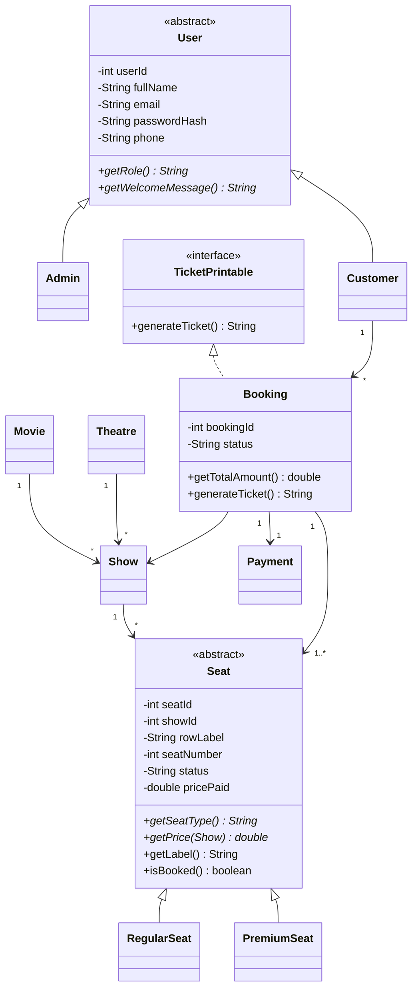

# Movie Ticket Booking System
Java (OOP) + Java Swing + JDBC + MySQL - college OOPs + DBMS project.

## 1. Folder structure

```
TicketBookingSystem/
├── README.md                      <- this file (docs, setup, screenshots, viva)
├── pom.xml                        <- optional Maven build
├── compile.bat / run.bat          <- Windows
├── compile.sh  / run.sh           <- Linux / macOS
├── sql/ticket_booking.sql         <- full schema + sample data
├── lib/                           <- put mysql-connector-j-x.x.x.jar here
└── src/
    ├── model/       User(abstract), Admin, Customer, Movie, Theatre, Show,
    │                Seat(abstract), RegularSeat, PremiumSeat, Booking, Payment,
    │                TicketPrintable(interface)
    ├── dao/         UserDAO, MovieDAO, TheatreDAO, ShowDAO, SeatDAO,
    │                BookingDAO, PaymentDAO, ReportDAO
    ├── service/     AuthService, AdminService, BookingService, ReportService
    ├── exception/   SeatUnavailableException, InvalidLoginException,
    │                DuplicateEmailException, ValidationException, BookingException
    ├── util/        DBConnection, PasswordUtil
    └── ui/          Main, LoginFrame, RegisterDialog, AdminDashboard,
                     MoviePanel, TheatrePanel, ShowPanel, ReportPanel,
                     CustomerDashboard, BrowseShowsPanel, MyBookingsPanel,
                     SeatMapDialog, TicketDialog, UIUtil
```

Layers: **UI -> Service -> DAO -> Database**. The UI never writes SQL, DAOs never show dialogs,
services hold the business rules (validation, transactions, pricing).

## 2. ER diagram description

| Relationship | Cardinality |
|---|---|
| Movie - Show | 1 : N |
| Theatre - Show | 1 : N |
| Show - Seat | 1 : N |
| User - Booking | 1 : N |
| Show - Booking | 1 : N |
| Booking - Seat | M : N (resolved by `booking_seats`) |
| Booking - Payment | 1 : 1 |

```
USERS ──< BOOKINGS >── SHOWS >── MOVIES
             │  │        │
             │  │        └──< SEATS
             │  └── BOOKING_SEATS ──┘
             └── 1:1 ── PAYMENTS
THEATRES ──< SHOWS
```

### Table schema (PK = primary key, FK = foreign key)

| Table | Columns |
|---|---|
| users | **user_id** PK, full_name, email UNIQUE, password_hash, phone, role (ADMIN/CUSTOMER), created_at |
| movies | **movie_id** PK, title, genre, language, duration_minutes, release_date; UNIQUE(title, language) |
| theatres | **theatre_id** PK, name, city, address; UNIQUE(name, city) |
| shows | **show_id** PK, movie_id FK, theatre_id FK, show_date, show_time, regular_price, premium_price, total_seats; UNIQUE(theatre, date, time) |
| seats | **seat_id** PK, show_id FK, row_label, seat_number, seat_type, status; UNIQUE(show, row, number) |
| bookings | **booking_id** PK, user_id FK, show_id FK, booking_time, status (CONFIRMED/CANCELLED) |
| booking_seats | **(booking_id, seat_id)** composite PK, both FK, price_paid |
| payments | **payment_id** PK, booking_id FK UNIQUE, amount, payment_mode, payment_status, payment_time |

**3NF notes:** movie/theatre facts are stored once and referenced by ID; the booking total is not stored
(it is the sum of `booking_seats.price_paid`, and `payments.amount` records what was paid);
`booking_seats` removes the many-to-many between bookings and seats. `seats.status` is a deliberate
operational flag so seats can be locked and checked quickly during booking.

## 3. Class diagram description



In words:
- **User** (abstract) is the parent of **Admin** and **Customer** (inheritance). Each overrides `getRole()` and `getWelcomeMessage()` (polymorphism).
- **Seat** (abstract) is the parent of **RegularSeat** and **PremiumSeat**. Each overrides `getPrice(Show)`: regular seats return the show's regular price, premium seats the premium price.
- **Booking** implements the **TicketPrintable** interface (`generateTicket()`).
- A **Show** links one **Movie** and one **Theatre** and owns many **Seats**. A **Booking** belongs to one customer and one show, holds one or more seats, and has exactly one **Payment**.
- All fields are `private` with getters/setters (encapsulation).

## 4. Setup and run

### Step 1 - Install the tools
- JDK 17 or newer (`java -version` and `javac -version` must both work)
- MySQL Server **8.0.16 or newer** (older versions ignore CHECK constraints) and MySQL Workbench or the `mysql` command line

### Step 2 - Create the database
Using the command line:
```
mysql -u root -p < sql/ticket_booking.sql
```
Or in MySQL Workbench: File > Open SQL Script > `sql/ticket_booking.sql` > run it (lightning icon).
Check it worked:
```sql
USE ticket_booking_db;
SELECT COUNT(*) FROM seats;      -- 150
SELECT * FROM payments;          -- amount 700.00
```

### Step 3 - Add the JDBC connector
1. Download **Connector/J** (Platform Independent) from https://dev.mysql.com/downloads/connector/j/
2. Unzip it and copy `mysql-connector-j-8.x.x.jar` into the `lib/` folder.
   (If you use Maven, skip this: `pom.xml` downloads it for you.)

### Step 4 - Set your MySQL password
Open `src/util/DBConnection.java` and change:
```java
private static final String USER = "root";
private static final String PASSWORD = "your_password";
```

### Step 5 - Compile and run
Windows: double-click `compile.bat`, then `run.bat` (or run them in a terminal).
Linux / macOS: `./compile.sh` then `./run.sh`.

Maven alternative: `mvn compile exec:java -Dexec.mainClass=ui.Main`

In Eclipse / IntelliJ / NetBeans: create a Java project, use `src` as the source folder, add the connector JAR to the build path, run `ui.Main`.

### Default logins (from the sample data)
| Role | Email | Password |
|---|---|---|
| Admin | admin@movies.com | admin123 |
| Customer | rahul@mail.com | pass123 |
| Customer | priya@mail.com | pass123 |

To register a new **Admin** in the app, the secret key is `ADMIN@2026` (constant in `AuthService`).

### Troubleshooting
| Problem | Fix |
|---|---|
| "MySQL JDBC driver not found" | The connector JAR is not in `lib/`, or the classpath in `run.bat` is wrong |
| "Access denied for user" | Wrong USER/PASSWORD in `DBConnection.java` |
| "Unknown database ticket_booking_db" | Run the SQL script first |
| "Communications link failure" | MySQL service is not running or the port is not 3306 |
| Sample shows are missing | Sample shows are created for *tomorrow and the day after* relative to the day you ran the script. Re-run the script, or add a show as admin |

## 5. How double booking is prevented
`BookingService.bookSeats()` runs one transaction:
1. `setAutoCommit(false)` starts the transaction.
2. `SELECT ... FOR UPDATE` locks the chosen seat rows. A second customer trying the same seats waits here.
3. If any locked seat is already `BOOKED`, `SeatUnavailableException` is thrown and the transaction is rolled back.
4. Otherwise the booking, booking_seats and payment rows are inserted, seats are marked `BOOKED`, and the transaction commits.
Any error triggers a rollback, so you never get a half-finished booking.

**Demo for your viva:** run the app twice (two terminals), log in as two customers, open the same show and select the same seat in both windows. Book in window 1, then book in window 2: window 2 shows "Seat A5 was just booked by someone else".

## 6. Screenshots / outputs to capture
1. MySQL Workbench: the `ticket_booking_db` schema with all 8 tables in the navigator
2. The ER diagram (Workbench: Database > Reverse Engineer)
3. Output of `DESCRIBE` for each table (or the Workbench table design view)
4. Sample data: `SELECT * FROM users / movies / theatres / shows / seats / bookings / payments`
5. Login screen
6. Register screen (customer, and admin with the secret key)
7. Failed login (wrong password) error dialog
8. Admin dashboard: Movies tab with add / update / delete in action
9. Admin: Theatres tab
10. Admin: Shows tab, with the success message "Show added and seat map created"
11. Admin: error when deleting a movie that has shows
12. Customer dashboard: Browse Shows tab
13. Seat map with available, premium, booked and selected seats, and the live total
14. Payment mode selection and the ticket summary dialog after booking
15. The print dialog (Print button on the ticket)
16. My Bookings tab showing CONFIRMED and CANCELLED bookings
17. Cancellation confirmation, then the refreshed seat map (seats green again) and payment status REFUNDED in the `payments` table
18. Double-booking prevention: the "already booked by someone else" error
19. Admin Reports: Bookings per Show, Total Revenue and Seat Occupancy
20. `SELECT * FROM users` showing hashed passwords (not plain text)
21. Project folder structure in your IDE
22. Console / IDE output showing "Connected to MySQL successfully."

## 7. Viva questions and answers

### OOP

**Q1. What is abstraction? Where is it used?**
Hiding unnecessary details and showing only what is needed. `User` and `Seat` are abstract classes (they cannot be instantiated and declare abstract methods), and `TicketPrintable` is an interface that only says "something that can produce a ticket".

**Q2. Where is inheritance used?**
`Admin` and `Customer` extend `User`; `RegularSeat` and `PremiumSeat` extend `Seat`. Common fields and methods are written once in the parent.

**Q3. Where is polymorphism used?**
`seat.getPrice(show)` is called on a `Seat` reference, but Java runs `RegularSeat.getPrice` or `PremiumSeat.getPrice` depending on the real object (runtime polymorphism / method overriding). The same happens with `user.getRole()`.

**Q4. What is encapsulation?**
Fields are `private` and only reachable through getters/setters, so the class controls how its data changes. Example: `Booking.getTotalAmount()` is calculated, so no one can set an inconsistent total.

**Q5. Abstract class vs interface?**
An abstract class can hold fields and constructors and models an "is-a" relationship (a `RegularSeat` is a `Seat`). An interface defines a capability (`TicketPrintable`) and a class can implement many interfaces but extend only one class.

**Q6. Why custom exceptions?**
They carry a meaningful name and message for each failure (`SeatUnavailableException`, `InvalidLoginException`) so the UI can react properly, instead of catching a generic `Exception`. They are *checked* exceptions, so the compiler forces callers to handle them.

**Q7. Method overloading vs overriding in this project?**
Overriding: `getPrice()` and `getRole()` in subclasses. Overloading: the constructors of `User`/`Movie` (no-arg and full-argument versions).

**Q8. What is the factory method here?**
`Seat.create(String type)` returns a `RegularSeat` or `PremiumSeat` depending on the database value, so the DAO does not need `if/else` everywhere.

**Q9. Why a layered architecture?**
Separation of concerns: the UI can change without touching SQL, and the SQL can change without touching the screens. Each layer is easy to test and understand.

**Q10. What is the DAO pattern?**
A Data Access Object keeps all SQL for one table in one class. The rest of the program works with objects (`Movie`, `Show`), not result sets.

### DBMS

**Q11. What is normalization? Is the schema in 3NF?**
Removing redundancy by splitting data into related tables. 1NF: atomic values. 2NF: no partial dependency on part of a composite key. 3NF: no transitive dependency (non-key columns depend only on the key). Movie and theatre details are stored once and referenced from `shows`; the many-to-many booking/seat relation has its own table.

**Q12. Why is there a `booking_seats` table?**
One booking has many seats and one seat can appear in many bookings over time (after cancellation it can be booked again), a many-to-many relationship. It also stores `price_paid` per seat.

**Q13. What constraints are used?**
PRIMARY KEY, FOREIGN KEY (with RESTRICT / CASCADE), UNIQUE (email, theatre+date+time, show+row+seat), NOT NULL, CHECK (price >= 0, seats between 1 and 260), ENUM and DEFAULT values.

**Q14. Explain ON DELETE RESTRICT vs CASCADE.**
RESTRICT blocks deleting a parent row that still has children (you cannot delete a movie that has shows). CASCADE deletes the children automatically (deleting a show deletes its seats).

**Q15. What is a transaction? What are the ACID properties?**
A group of SQL statements that succeed or fail as one unit. Atomicity (all or nothing), Consistency (constraints stay valid), Isolation (concurrent transactions do not interfere), Durability (committed data survives a crash).

**Q16. How is double booking prevented?**
In one transaction we run `SELECT ... FOR UPDATE` on the chosen seats (row-level lock in InnoDB), check their status, then update them and commit. A second transaction wanting the same rows waits, then sees `BOOKED` and fails with `SeatUnavailableException`.

**Q17. What is SQL injection and how do you avoid it?**
Attackers put SQL into input (`' OR '1'='1`). We use `PreparedStatement` with `?` placeholders so input is always treated as data, never as SQL. Even the dynamic `IN (?,?,?)` only builds question marks; the values are bound.

**Q18. How are passwords protected?**
Only the SHA-256 hash is stored, never the plain password. Login hashes the typed password and compares hashes. (In production you would add a salt and use a slow hash such as bcrypt or Argon2, because plain SHA-256 is fast to brute-force and identical passwords give identical hashes.)

**Q19. Statement vs PreparedStatement?**
`PreparedStatement` is precompiled, safer (no injection), faster when reused, and handles types and quoting for you.

**Q20. What is a JOIN? Which ones are used?**
Combining rows from tables on a related column. INNER JOIN (shows + movies + theatres) and LEFT JOIN (reports keep shows that have no bookings yet).

**Q21. What do the reports use?**
`GROUP BY` with aggregates: `COUNT` (bookings and seats per show), `SUM` (revenue), `COALESCE` (0 instead of NULL), and `CASE WHEN` inside `SUM` to count booked seats.

**Q22. What is a stored procedure and why `sp_generate_seats`?**
Named SQL code stored in the database. It creates all seat rows for a show in one call, inside the same transaction as the show insert.

**Q23. What is JDBC? Steps to connect?**
Java's standard API for databases. Load the driver, get a `Connection` from `DriverManager`, create a `PreparedStatement`, execute it, read the `ResultSet`, close everything (here via try-with-resources).

**Q24. Why use `try-with-resources`?**
It closes the Connection, Statement and ResultSet automatically, even when an exception occurs, avoiding connection leaks.

## 8. Known limitations (good to mention honestly in the viva)
- Payment is **simulated**: it is recorded as SUCCESS with the chosen mode; there is no real gateway.
- Passwords use unsalted SHA-256 (kept simple so the SQL sample data can use `SHA2()`); see Q18.
- Each DAO call opens a new connection (simple, no pool). Fine for a college project; real systems use a connection pool.
- No "hold seats for N minutes" feature: seats are locked only during the booking transaction.
