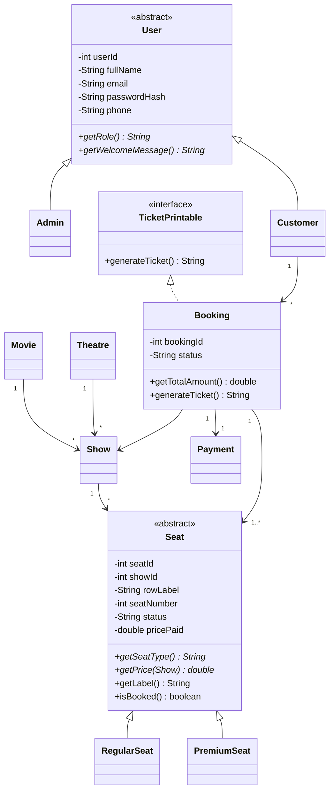

# Movie Ticket Booking System
Java (OOP) + Java Swing + JDBC + MySQL

## 1. Folder structure

```
TicketBookingSystem/
├── README.md                      <- this file (docs, setup, screenshots, viva)
├── pom.xml                        <- optional Maven build
├── compile.bat / run.bat          <- Windows
├── compile.sh  / run.sh           <- Linux / macOS
├── sql/ticket_booking.sql         <- full schema + sample data
├── lib/                           <- put mysql-connector-j-x.x.x.jar here
└── src/
    ├── model/       User(abstract), Admin, Customer, Movie, Theatre, Show,
    │                Seat(abstract), RegularSeat, PremiumSeat, Booking, Payment,
    │                TicketPrintable(interface)
    ├── dao/         UserDAO, MovieDAO, TheatreDAO, ShowDAO, SeatDAO,
    │                BookingDAO, PaymentDAO, ReportDAO
    ├── service/     AuthService, AdminService, BookingService, ReportService
    ├── exception/   SeatUnavailableException, InvalidLoginException,
    │                DuplicateEmailException, ValidationException, BookingException
    ├── util/        DBConnection, PasswordUtil
    └── ui/          Main, LoginFrame, RegisterDialog, AdminDashboard,
                     MoviePanel, TheatrePanel, ShowPanel, ReportPanel,
                     CustomerDashboard, BrowseShowsPanel, MyBookingsPanel,
                     SeatMapDialog, TicketDialog, UIUtil
```

Layers: **UI -> Service -> DAO -> Database**. The UI never writes SQL, DAOs never show dialogs,
services hold the business rules (validation, transactions, pricing).

## 2. ER diagram description

| Relationship | Cardinality |
|---|---|
| Movie - Show | 1 : N |
| Theatre - Show | 1 : N |
| Show - Seat | 1 : N |
| User - Booking | 1 : N |
| Show - Booking | 1 : N |
| Booking - Seat | M : N (resolved by `booking_seats`) |
| Booking - Payment | 1 : 1 |

```
USERS ──< BOOKINGS >── SHOWS >── MOVIES
             │  │        │
             │  │        └──< SEATS
             │  └── BOOKING_SEATS ──┘
             └── 1:1 ── PAYMENTS
THEATRES ──< SHOWS
```

### Table schema (PK = primary key, FK = foreign key)

| Table | Columns |
|---|---|
| users | **user_id** PK, full_name, email UNIQUE, password_hash, phone, role (ADMIN/CUSTOMER), created_at |
| movies | **movie_id** PK, title, genre, language, duration_minutes, release_date; UNIQUE(title, language) |
| theatres | **theatre_id** PK, name, city, address; UNIQUE(name, city) |
| shows | **show_id** PK, movie_id FK, theatre_id FK, show_date, show_time, regular_price, premium_price, total_seats; UNIQUE(theatre, date, time) |
| seats | **seat_id** PK, show_id FK, row_label, seat_number, seat_type, status; UNIQUE(show, row, number) |
| bookings | **booking_id** PK, user_id FK, show_id FK, booking_time, status (CONFIRMED/CANCELLED) |
| booking_seats | **(booking_id, seat_id)** composite PK, both FK, price_paid |
| payments | **payment_id** PK, booking_id FK UNIQUE, amount, payment_mode, payment_status, payment_time |

**3NF notes:** movie/theatre facts are stored once and referenced by ID; the booking total is not stored
(it is the sum of `booking_seats.price_paid`, and `payments.amount` records what was paid);
`booking_seats` removes the many-to-many between bookings and seats. `seats.status` is a deliberate
operational flag so seats can be locked and checked quickly during booking.

## 3. Class diagram description



In words:
- **User** (abstract) is the parent of **Admin** and **Customer** (inheritance). Each overrides `getRole()` and `getWelcomeMessage()` (polymorphism).
- **Seat** (abstract) is the parent of **RegularSeat** and **PremiumSeat**. Each overrides `getPrice(Show)`: regular seats return the show's regular price, premium seats the premium price.
- **Booking** implements the **TicketPrintable** interface (`generateTicket()`).
- A **Show** links one **Movie** and one **Theatre** and owns many **Seats**. A **Booking** belongs to one customer and one show, holds one or more seats, and has exactly one **Payment**.
- All fields are `private` with getters/setters (encapsulation).

## 4. Setup and run

### Step 1 - Install the tools
- JDK 17 or newer (`java -version` and `javac -version` must both work)
- MySQL Server **8.0.16 or newer** (older versions ignore CHECK constraints) and MySQL Workbench or the `mysql` command line

### Step 2 - Create the database
Using the command line:
```
mysql -u root -p < sql/ticket_booking.sql
```
Or in MySQL Workbench: File > Open SQL Script > `sql/ticket_booking.sql` > run it (lightning icon).
Check it worked:
```sql
USE ticket_booking_db;
SELECT COUNT(*) FROM seats;      -- 150
SELECT * FROM payments;          -- amount 700.00
```

### Step 3 - Add the JDBC connector
1. Download **Connector/J** (Platform Independent) from https://dev.mysql.com/downloads/connector/j/
2. Unzip it and copy `mysql-connector-j-8.x.x.jar` into the `lib/` folder.
   (If you use Maven, skip this: `pom.xml` downloads it for you.)

### Step 4 - Set your MySQL password
Open `src/util/DBConnection.java` and change:
```java
private static final String USER = "root";
private static final String PASSWORD = "your_password";
```

### Step 5 - Compile and run
Windows: double-click `compile.bat`, then `run.bat` (or run them in a terminal).
Linux / macOS: `./compile.sh` then `./run.sh`.

Maven alternative: `mvn compile exec:java -Dexec.mainClass=ui.Main`

In Eclipse / IntelliJ / NetBeans: create a Java project, use `src` as the source folder, add the connector JAR to the build path, run `ui.Main`.

### Default logins (from the sample data)
| Role | Email | Password |
|---|---|---|
| Admin | admin@movies.com | admin123 |
| Customer | rahul@mail.com | pass123 |
| Customer | priya@mail.com | pass123 |

To register a new **Admin** in the app, the secret key is `ADMIN@2026` (constant in `AuthService`).

### Troubleshooting
| Problem | Fix |
|---|---|
| "MySQL JDBC driver not found" | The connector JAR is not in `lib/`, or the classpath in `run.bat` is wrong |
| "Access denied for user" | Wrong USER/PASSWORD in `DBConnection.java` |
| "Unknown database ticket_booking_db" | Run the SQL script first |
| "Communications link failure" | MySQL service is not running or the port is not 3306 |
| Sample shows are missing | Sample shows are created for *tomorrow and the day after* relative to the day you ran the script. Re-run the script, or add a show as admin |

## 5. How double booking is prevented
`BookingService.bookSeats()` runs one transaction:
1. `setAutoCommit(false)` starts the transaction.
2. `SELECT ... FOR UPDATE` locks the chosen seat rows. A second customer trying the same seats waits here.
3. If any locked seat is already `BOOKED`, `SeatUnavailableException` is thrown and the transaction is rolled back.
4. Otherwise the booking, booking_seats and payment rows are inserted, seats are marked `BOOKED`, and the transaction commits.
Any error triggers a rollback, so you never get a half-finished booking.
